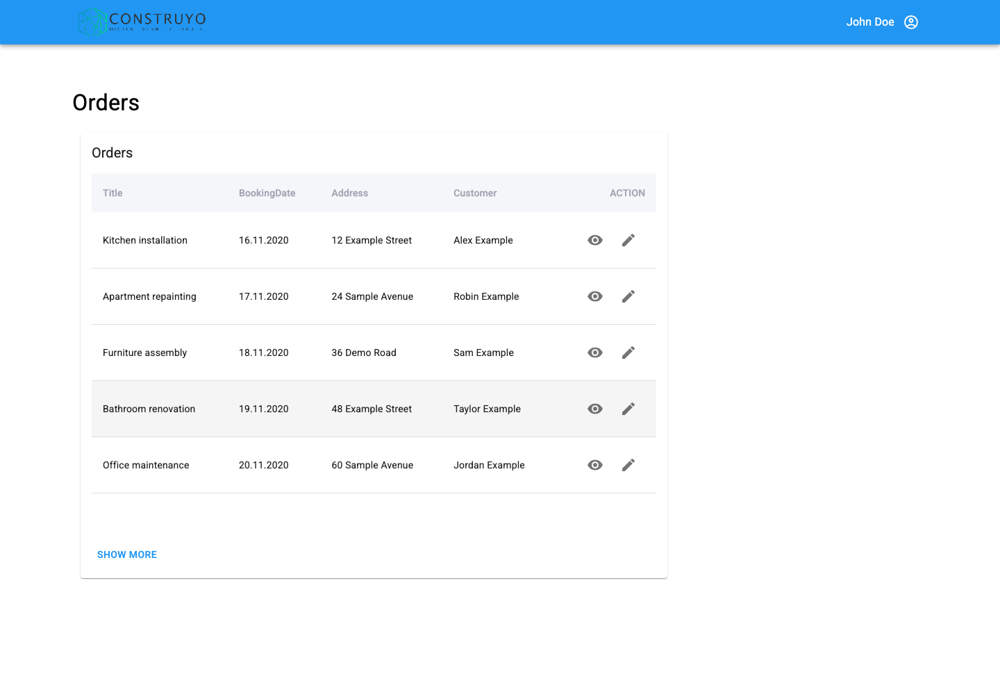
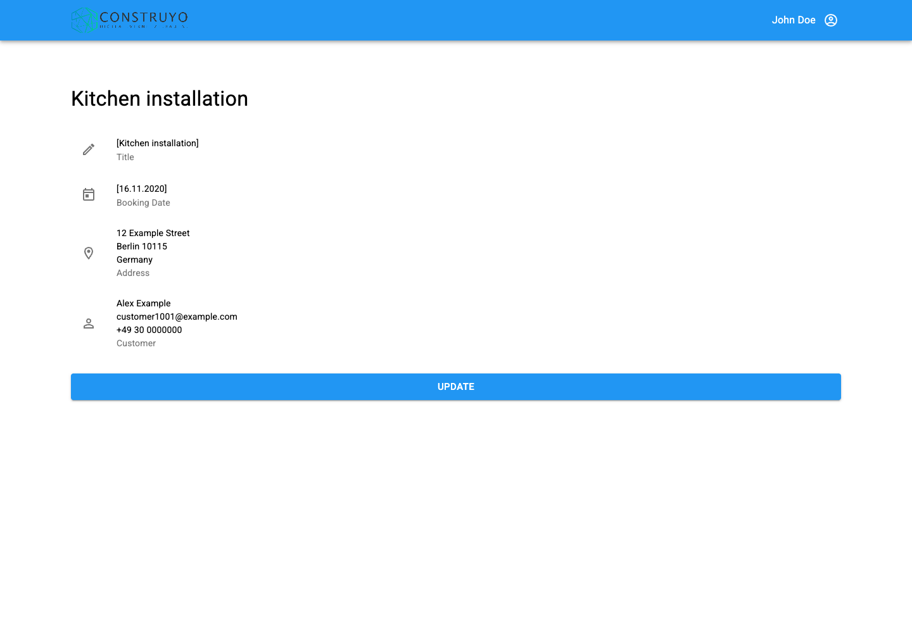
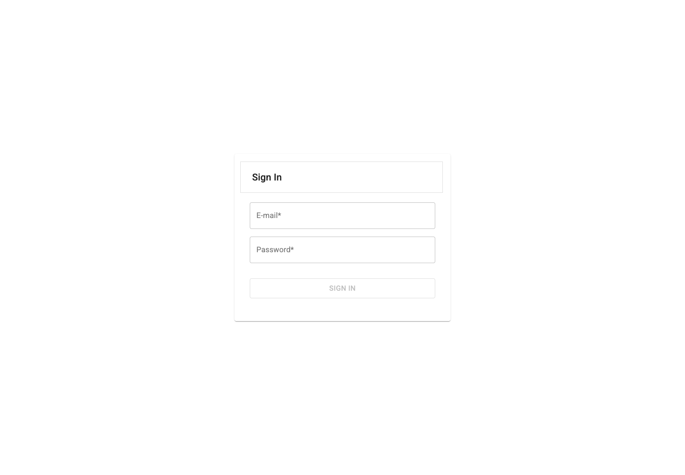

# Ruyo Client

Ruyo Client is the React and TypeScript frontend for an authenticated order-management application. It lets users browse orders, inspect booking dates, customer details and addresses, and open an order-editing drawer.

The application depends on **Firebase Authentication** and a **separate REST API**. Neither the backend nor the Firebase project configuration is included in this repository. This is a legacy codebase, not a standalone demo; its dependencies and unfinished workflows need attention before production use.

## Screenshots

These are browser screenshots of the repository's original UI components, rendered locally with simulated Firebase authentication and mocked REST responses. The screenshot-only preview used a separate bundler without changing the application source. Orders and contact details are fictional; these images do not demonstrate a working live backend. The preview harness is not included in the application, and there are no built-in demo credentials.

### Orders

The listing shows each order's title, booking date, street address and customer, with actions to view or edit an order.



### Order details

An individual order displays the full address and customer contact information. **Update** opens the edit drawer.



### Sign in

Protected pages redirect unauthenticated users to the email/password sign-in form.



## What is implemented

- Email/password sign-in through Firebase, followed by loading the user's profile from the backend.
- Protected orders listing and individual order pages.
- An edit drawer with title and booking-date inputs; address and customer fields are read-only when editing.
- Material UI layouts with a mobile navigation drawer, loading indicators and error notifications.
- Redux actions, reducers, selectors and sagas, with tests for authentication and orders.

See [Known limitations](#known-limitations) for incomplete features and date-handling issues.

## Technology

| Area                   | Libraries                                                                 |
| ---------------------- | ------------------------------------------------------------------------- |
| UI                     | React 16, TypeScript 3.8, Material UI 4                                   |
| Routing                | React Router 5                                                            |
| State and side effects | Redux, React Redux, Redux Saga                                            |
| Services               | Firebase 7, Axios                                                         |
| Forms and dates        | Formsy, Material UI Pickers, Moment                                       |
| Tooling                | Create React App / `react-scripts` 3.4.3, Jest, Testing Library, Prettier |

## Running locally

### Prerequisites

- Node.js and Yarn Classic (1.x). No Node.js version is pinned in the repository; see the legacy toolchain note below.
- A Firebase project with **Email/Password** authentication enabled and an existing test user.
- A compatible backend with a user profile matching that Firebase user's UID and the endpoints described below.

### 1. Install dependencies

```sh
git clone https://github.com/einnor/ruyo-client.git
cd ruyo-client
yarn install --frozen-lockfile
```

### 2. Configure the API URL

```sh
cp env.example .env
```

Set the backend's API base URL in `.env`:

```dotenv
REACT_APP_BACKEND_BASE_PATH=http://localhost:4000/api
```

The backend must accept requests from the frontend's origin, normally `http://localhost:3000`. Restart the development server after changing environment variables.

### 3. Configure Firebase

Create `src/config/firebaseConfig.js` using the web app configuration from your Firebase project:

```js
export default {
  apiKey: 'YOUR_FIREBASE_WEB_API_KEY',
  authDomain: 'YOUR_PROJECT_ID.firebaseapp.com',
  projectId: 'YOUR_PROJECT_ID',
  appId: 'YOUR_FIREBASE_WEB_APP_ID',
};
```

Both `.env` and `src/config/firebaseConfig.js` are gitignored. Use Firebase's **web client configuration**, never a service-account key or Admin SDK credentials. Allow `localhost` in your Firebase Authentication authorized domains when developing locally. The client also initializes Firestore, although the current order and profile services use the REST API.

### 4. Start the frontend

```sh
yarn start
```

Open `http://localhost:3000` and sign in with the Firebase test user. There is no registration screen; the Firebase account and corresponding backend profile must already exist.

### Legacy toolchain note

This project uses Webpack 4 through Create React App 3. On Node.js versions using OpenSSL 3, startup or builds can fail with `ERR_OSSL_EVP_UNSUPPORTED`. A temporary local compatibility workaround is:

```sh
NODE_OPTIONS=--openssl-legacy-provider yarn start
# For a production bundle:
NODE_OPTIONS=--openssl-legacy-provider yarn build
```

This addresses the hashing error only. It does not supply the missing Firebase configuration or backend, guarantee compatibility with modern Node.js releases, or replace a dependency/toolchain upgrade.

## Backend integration

The client sends a Firebase ID token as `Authorization: Bearer <token>` with profile and order requests. Paths below are relative to `REACT_APP_BACKEND_BASE_PATH`.

| Method | Path          | Expected successful response                                               |
| ------ | ------------- | -------------------------------------------------------------------------- |
| `GET`  | `/users/:uid` | User object with `uid`, `name`, `email` and `phone`                        |
| `GET`  | `/orders`     | Array of order objects                                                     |
| `GET`  | `/orders/:id` | A single order object                                                      |
| `PUT`  | `/orders/:id` | Updated order object; request body contains only `title` and `bookingDate` |

The response handler accepts HTTP `200` and `201` and returns the JSON body directly, without unwrapping a `data` property.

Example order, matching the shape used by the services and tests:

```json
{
  "id": "1001",
  "title": "Kitchen installation",
  "bookingDate": 1605528000000,
  "address": {
    "street": "12 Example Street",
    "city": "Berlin",
    "zip": "10115",
    "country": "Germany"
  },
  "customer": {
    "name": "Alex Example",
    "email": "customer1001@example.com",
    "phone": "+49 30 0000000"
  }
}
```

**Date units need reconciliation:** the listing, detail page and existing test fixtures treat `bookingDate` as milliseconds since the Unix epoch, while the edit form reads and submits Unix seconds. Confirm and correct this contract before relying on booking-date updates.

## Routes

| Route              | Screen         | Access                                  |
| ------------------ | -------------- | --------------------------------------- |
| `/sign-in`         | Sign in        | Redirects authenticated users to orders |
| `/` or `/orders`   | Orders listing | Requires authentication                 |
| `/orders/:id`      | Order details  | Requires authentication                 |
| Any unmatched path | Not found      | Public                                  |

## Tests and production build

```sh
yarn test
# Run once without watch mode:
CI=true yarn test --watchAll=false

yarn build
```

The production bundle is generated in `build/`. Serve it with an SPA fallback to `index.html` so direct visits to routes such as `/orders/1001` work. Firebase configuration and the backend URL must be supplied at build time.

## Project structure

```text
src/
  components/   Shared layouts, route guards, table and form inputs
  config/       Theme and environment helpers; local Firebase configuration
  containers/   Authentication, orders and order-detail screens
                Authentication and orders also contain Redux logic and tests
  i18n/         English UI strings
  pages/        Screen/layout composition
  services/     Firebase initialization, authentication and order API calls
  store/        Redux store, root reducer and sagas
```

## Known limitations

- Order creation and deletion are unfinished; their listing callbacks are placeholders and the add action is not enabled.
- **Show More** is rendered but does not load additional orders.
- Booking-date units differ between display and editing, as noted above.
- The header's **John Doe** name is hardcoded. Sign-out clears local storage but does not call Firebase's `signOut()` method.
- The original dependency stack is old. Review and update it before deploying; the screenshots document the existing interface, not production readiness.
